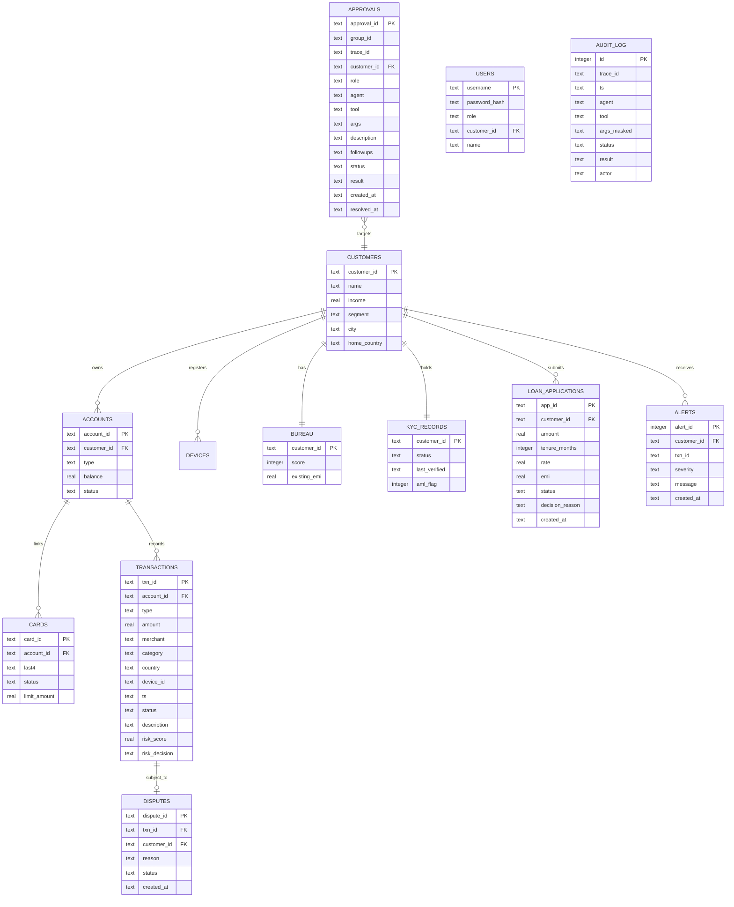

# Fingent Banking System: High-Level System Architecture

This document provides a comprehensive, end-to-end architectural breakdown of the **Fingent Autonomous Multi-Agent Banking Platform**. It defines the component topologies, security perimeters, data storage schemas, and inter-tier communication protocols.

---

## 1. System Topology Overview

Fingent is built upon a decoupled, defense-in-depth, micro-orchestrated architecture. It bridges modern single-page client applications with an agentic back-end powered by an **Observe–Think–Act–Evaluate–Correct (OTAEC)** orchestration state machine, deterministic safety guardrails, native LLM tool calling, and deterministic rule/ML models.

```mermaid
graph TB
    subgraph ClientTier ["Client Presentation Layer (React 18 + Vite)"]
        UI_Customer["Customer Banking Portal<br/>(Single-Account Scoped, Balances, Mini-Statements, P2P Transfers)"]
        UI_Supervisor["Supervisor & RM 360 Portal<br/>(Bank-Wide Search, Approval Queue, Cross-Customer Views)"]
        UI_Chat["Interactive Agent Console<br/>(Observe-Think-Act Telemetry, Inline HITL Cards, Tool Traces)"]
        UI_Alerts["Live Security & Risk Alert Feed<br/>(Drawer, Severity Badges, Immediate Triage Prompts)"]
    end

    subgraph GatewayTier ["FastAPI Gateway & Access Control Layer (Port 8000)"]
        AUTH["Session & Auth Engine (/auth/*)<br/>SHA-256 Salted Hashing, Bearer nxt_ tokens, 24h TTL"]
        RBAC["Customer Data Isolation Gate<br/>Customer ID scoping, 403 Forbidden on Cross-Access"]
        ROUTING["API Handlers (/chat, /approvals, /customers, /accounts)<br/>Framework-free, testable handler delegation"]
    end

    subgraph IntelligenceTier ["Orchestration & NLU Intelligence Core"]
        SUP["Supervisor Orchestrator<br/>(Observe–Think–Act–Evaluate–Correct State Machine)"]
        LADDER["Cost-Avoidance 4-Tier Ladder<br/>Tier 0 (Regex) ➔ Tier 1 (ML Classifier) ➔ Tier 2 (Small LLM) ➔ Tier 3 (Strong LLM)"]
        UNIFIED_NLU["Unified NLU & Tool Selector<br/>Native Tool Schema Provider, Slot Extraction, Typo Normalization"]
        PLANNER["DAG Task Planner<br/>Sequential Dependencies, Parallel Execution Groups"]
        EVAL["Self-Evaluator & Recovery Controller<br/>Mathematical & Policy Verification, Bounded Safe Retries"]
    end

    subgraph AgentTier ["Specialized Autonomous Domain Agents"]
        AG_BANK["Banking Agent<br/>(Balances, Mini-Statements, P2P Transfers)"]
        AG_FRAUD["Fraud & Risk Agent<br/>(IsolationForest Anomaly Scoring, Card Freezing, Disputes)"]
        AG_CREDIT["Credit & Lending Agent<br/>(Bureau Scoring, Eligibility Rules, EMI Engine, Origination)"]
        AG_COMP["Compliance & KYC Agent<br/>(Sanctions Screening, KYC Expiry, Transfer Threshold Gates)"]
        AG_NOTIF["Notification Agent<br/>(Security Alerts, SMS/Push Stubs, Approval Dispatches)"]
    end

    subgraph GovernanceTier ["Safety & Governance Boundaries"]
        TOOL_REG["Pydantic Tool Registry<br/>Strict Typing, Agent Allowlists, Parameter Sanitization"]
        PII_GATE["PII Masking & Guardrails<br/>Card/Account/Phone/Aadhaar Redaction, Injection Neutralization"]
        HITL_QUEUE["Human-in-the-Loop Approval Queue<br/>Idempotency Keys, State Freezing, Write Gatekeeping"]
        AUDIT_SYS["Auditable Execution Observatory<br/>Immutable Trace Logging, Millisecond Telemetry, Token Metrics"]
    end

    subgraph PersistenceTier ["Deterministic Persistence & Analytical Models"]
        SQLITE[("SQLite Database (WAL Mode)<br/>Transactional Consistency, Relational Isolation")]
        ML_FRAUD["IsolationForest Model (joblib)<br/>Multi-feature Anomaly Engine, Contamination Tuning"]
        ML_INTENT["TF-IDF + LogisticRegression<br/>Deterministic Intent Classification Engine"]
    end

    ClientTier -->|HTTP REST + Bearer Token| GatewayTier
    GatewayTier -->|Session Verified RequestState| IntelligenceTier
    IntelligenceTier -->|Structured Subtask Delegation| AgentTier
    AgentTier -->|Tool Calls via Context| GovernanceTier
    GovernanceTier -->|Authorized Queries & Updates| PersistenceTier
```



---

## 2. Directory Layout & Module Structure

The project repository is structured cleanly into backend (`banking-agents`) and frontend (`frontend`) subsystems:

```
banking-agents-core/
├── README.md                           # Monorepo overview and quick-start instructions
├── architecture_report/                # Comprehensive architectural and orchestration specifications
│   ├── 01_SYSTEM_ARCHITECTURE.md       # High-level architecture, components, and data topology
│   ├── 02_ORCHESTRATION_AND_LIFECYCLE.md # OTAEC state machine, planning, parallel execution
│   ├── 03_MULTI_AGENT_SPECIFICATION.md # Agent roles, allowlists, and domain capabilities
│   ├── 04_NLU_LADDER_AND_TOOL_CALLING.md # NLU routing, 4-tier ladder, native tool calling
│   ├── 05_SAFETY_GUARDRAILS_AND_HITL.md # Isolation, PII, prompt injection, HITL approvals
│   ├── 06_DATA_ML_AND_RULE_ENGINES.md   # Schema, ML models, and business calculation rules
│   ├── 07_FRONTEND_AND_OBSERVATORY.md  # React dashboard, component hierarchy, telemetry UI
│   └── README.md                       # Architecture document index and navigation guide
├── banking-agents/                     # Python 3.10+ FastAPI Multi-Agent Banking Core
│   ├── app/
│   │   ├── main.py                     # FastAPI application setup, CORS, route declarations
│   │   ├── handlers.py                 # Framework-agnostic controller logic and session translation
│   │   ├── auth.py                     # Salted SHA-256 hashing, session tokens, user seeding
│   │   ├── config.py                   # Environment settings, pricing cards, and bank policy loader
│   │   ├── db.py                       # Thread-safe SQLite connection manager, schema initialization
│   │   ├── state.py                    # Session, RequestState, token counters, audit event emitter
│   │   ├── rules.py                    # Deterministic business logic (EMI formula, FOIR, KYC, Fraud)
│   │   ├── services.py                 # Data access layer for accounts, loans, cards, transactions
│   │   ├── ladder.py                   # 4-tier cost-avoidance ladder routing logic
│   │   ├── metrics.py                  # Telemetry tracking (latency, token costs, LLM avoidance)
│   │   ├── util.py                     # Indian currency formatter (INR ₹), timestamp utilities
│   │   ├── knowledge.py                # RAG knowledge base search over banking guidelines
│   │   ├── stream.py                   # Live synthetic transaction streaming daemon
│   │   ├── supervisor/                 # Orchestration Subsystem
│   │   │   ├── orchestrator.py         # SupervisorOrchestrator: Observe-Think-Act-Evaluate-Correct
│   │   │   ├── planner.py              # WorkflowPlanner: DAG decomposition, parallel task planner
│   │   │   ├── self_evaluator.py       # SelfEvaluator: Data consistency & policy compliance gate
│   │   │   ├── recovery.py             # RecoveryController: Bounded self-correction, retry guardrails
│   │   │   └── workflow_state.py       # Dataclasses: WorkflowState, ObserveResult, TaskPlan
│   │   ├── agents/                     # Specialized Domain Agents
│   │   │   ├── base.py                 # BaseAgent abstract class, budget counter, dispatch
│   │   │   ├── banking.py              # Account balances, statement retrieval, P2P money transfers
│   │   │   ├── credit.py               # Bureau score retrieval, loan underwriting, EMI calculation
│   │   │   ├── fraud.py                # Suspicious transaction triage, card blocking, disputes
│   │   │   ├── compliance.py           # KYC verification, AML screening, transfer gating
│   │   │   └── notification.py         # Customer security and transaction alert dispatching
│   │   ├── tools/                      # Tool Registry & Permissions
│   │   │   ├── registry.py             # Tool registration, allowlist check, approval gating
│   │   │   ├── definitions.py          # Concrete tool implementations and Pydantic argument schemas
│   │   │   ├── approvals.py            # SQLite-backed pending approval groups and decisions
│   │   │   └── audit.py                # Auditable tool invocation logging
│   │   ├── gateway/                    # Safety, Privacy, and Cost Controls
│   │   │   ├── gateway.py              # LLM gateway dispatcher, model fallbacks, token budget
│   │   │   ├── guardrail.py            # Indirect prompt-injection filtering, numerical grounding
│   │   │   ├── pii.py                  # Regex PII scrubbing (Aadhaar, PAN, Card, Phone, Email)
│   │   │   └── budget.py               # Request-level step and token budget limiters
│   │   ├── llm/                        # Natural Language & Model Abstractions
│   │   │   ├── client.py               # Provider-agnostic client (OpenAI, Anthropic, Mock)
│   │   │   ├── nlu.py                  # Unified NLU, dynamic tool calling, slot extraction
│   │   │   ├── mock.py                 # Dynamic mock inference engine for offline demonstrations
│   │   │   └── typo_normalizer.py      # Pre-NLU typo corrector for informal banking queries
│   │   └── ml/                         # Local Machine Learning Models
│   │       ├── fraud.py                # Scikit-learn IsolationForest anomaly model
│   │       ├── intent_model.py         # TF-IDF + LogisticRegression intent classifier
│   │       ├── train.py                # CLI runner to fit both models
│   │       └── training_data.py        # Curated banking intent corpus for classifier
│   ├── config/
│   │   └── policy.json                 # Bank lending policies, rate cards, risk thresholds
│   ├── data/
│   │   ├── seed.py                     # Realistic database seeder (10 personas, transactions)
│   │   ├── bank.db                     # Active SQLite database file
│   │   └── docs/                       # Raw policy markdown documents for RAG search
│   ├── eval/                           # Multi-turn benchmark evaluation runner
│   │   ├── prompts.jsonl               # Standardized golden test prompts
│   │   └── run.py                      # Evaluation benchmark harness
│   ├── tests/                          # Automated Pytest Suite (70+ unit and integration tests)
│   │   ├── test_50_queries.py          # 50+ language queries, edge cases, typo resilience
│   │   ├── test_observe_think_act.py   # Full OTAEC lifecycle tests across the 6 core use cases
│   │   ├── test_supervisor.py          # Cross-agent routing, approval workflows, AML masking
│   │   ├── test_critical_fixes.py      # Customer isolation, P2P dual ledger, RBAC boundary tests
│   │   ├── test_dynamic_llm_and_auth.py# Authentication, token generation, mock vs live LLM
│   │   ├── test_tools.py               # Tool registry permission allowlists and schemas
│   │   ├── test_ladder.py              # Cost avoidance ladder escalation behavior
│   │   └── test_engines.py             # Math formulas (EMI, FOIR), fraud rules, KYC verdicts
│   ├── requirements.txt                # Python backend dependencies
│   └── README.md                       # Backend-focused technical documentation
└── frontend/                           # React 18 + Vite SPA Dashboard
    ├── index.html                      # Single-page HTML entry point
    ├── vite.config.js                  # Vite configuration and reverse-proxy setup
    ├── package.json                    # Node dependencies (Lucide icons, Vite, React)
    └── src/
        ├── App.jsx                     # Root application container, session gate, tab manager
        ├── App.css                     # Design tokens, glassmorphism UI, themes, responsive CSS
        ├── api.js                      # Centralized API client with automatic Bearer token injection
        ├── main.jsx                    # React DOM bootstrapper
        ├── components/
        │   ├── Navbar.jsx              # App header, role switch, target customer selector, LLM toggle
        │   ├── LoginPage.jsx           # Clean authentication modal for customer and supervisor demo accounts
        │   ├── ChatView.jsx            # Conversational assistant, inline OTA badges, approval cards
        │   ├── CustomerView.jsx        # Customer 360 view (balances, transactions, cards, loans, KYC)
        │   ├── ApprovalsView.jsx       # Supervisor approval management console
        │   ├── ObservatoryView.jsx     # Live system observatory (audit logs, metrics, stream)
        │   └── AlertsDrawer.jsx        # Slide-over real-time fraud alert triage panel
        └── utils/
            └── formatText.js           # Markdown and currency formatting helpers
```

---

## 3. Database Relational Schema

All operational bank state is stored deterministically in SQLite using Write-Ahead Logging (`PRAGMA journal_mode=WAL`), preventing database lock contention between background transaction streaming and active agent tasks.



---

## 4. Authentication, Session Tokens, and RBAC

The system employs a strict identity and role-based access control (RBAC) model implemented in `app/auth.py` and enforced across all API routes in `app/handlers.py`:

### Authentication Mechanism
1. **Password Storage**: Passwords are never stored in plaintext. They are hashed using SHA-256 with an application-specific cryptographic salt (`_hash_password(password)`).
2. **Session Generation**: Upon successful authentication at `POST /auth/login`, the server generates a cryptographically secure random Bearer token:
   $$\text{Token} = \text{"nxt\_"} + \text{secrets.token\_hex(24)}$$
3. **Session Lifecycle**: Active tokens are cached in thread-safe memory with an explicit expiration timestamp (24-hour TTL).
4. **Session Invalidation**: Calling `POST /auth/logout` immediately evicts the token from memory.

### Role-Based Access Control (RBAC) Matrix

| Operation / Endpoint | Customer Role (`customer`) | Relationship Manager (`rm`) | Supervisor (`supervisor`) |
| :--- | :--- | :--- | :--- |
| **View Own Account & Balance** | ✅ Permitted (Own `customer_id` only) | ✅ Permitted | ✅ Permitted |
| **View Another Customer's Balance** | 🚫 **HTTP 403 Forbidden** | ✅ Permitted (For investigation) | ✅ Permitted (For investigation) |
| **Search / Disambiguate Any Customer** | 🚫 **HTTP 403 / Blocked** | ✅ Permitted | ✅ Permitted |
| **P2P Transfer to Named Beneficiary** | ✅ Allowed (Dual ledger update) | ✅ Allowed | ✅ Allowed |
| **Initiate Write Action (Loan, Block)** | ⚠️ Stages into Pending Approval | ⚠️ Stages into Pending Approval | ⚠️ Stages into Pending Approval |
| **Approve Own Pending Write Group** | ✅ Permitted (For customer-initiated) | ✅ Permitted | ✅ Permitted |
| **Approve Other Customer's Actions** | 🚫 **Access Denied** | ✅ Permitted (Management review) | ✅ Permitted (Central approval lead) |
| **View Bank-Wide Approval Queue** | 🚫 Scoped to self only | ✅ Bank-wide queue | ✅ Bank-wide queue |
| **Toggle LLM Active / Mock Mode** | 🚫 Read-only status | ✅ Permitted | ✅ Permitted |
