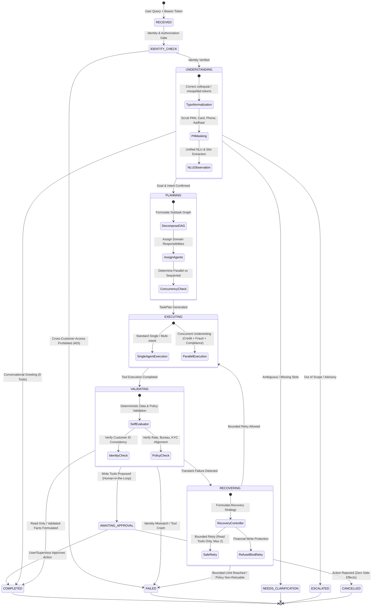
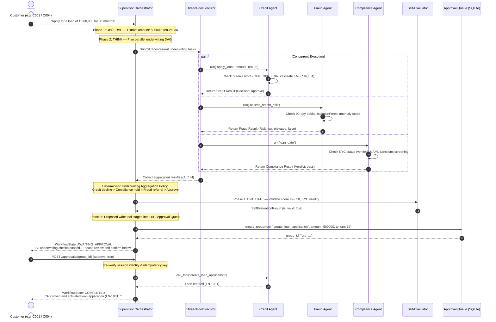

# Fingent Multi-Agent Orchestration & Workflow Lifecycle

This document provides a detailed specification of the orchestration subsystem in **Fingent**. It covers the **Observe–Think–Act–Evaluate–Correct (OTAEC)** lifecycle, the finite state machine, DAG task planning, concurrent multi-agent underwriting, deterministic evaluation gates, and bounded self-correction.

---

## 1. Orchestration State Machine

Every request entering the Supervisor Orchestrator (`app/supervisor/orchestrator.py`) transitions through explicit, auditable workflow lifecycle states defined in `WorkflowState` (`app/supervisor/workflow_state.py`):



---

## 2. The 6-Stage Observe–Think–Act–Evaluate–Correct (OTAEC) Lifecycle

### Stage 0: Identity Resolution & Security Gate
- **Pre-execution Normalization**: Incoming text is sanitized via `normalize_banking_query` to fix colloquialisms and spelling mistakes (e.g., *"balnce"*, *"cbil scor"*, *"plz blck crd"*).
- **PII Redaction**: All identifiers, 16-digit card numbers, and sensitive strings are masked before any classification or model sees them.
- **Access Authorization**:
  - If `role == "customer"`: The customer may **only** access records matching their authenticated `customer_id`. Mentioning another customer's ID (e.g., `C002`) on read queries results in an immediate **`HTTP 403 Forbidden`**. Exception: Mentioning a beneficiary for legitimate P2P money transfers (`transfer_money`) resolves the beneficiary's receiving account while keeping execution strictly scoped to the sender.
  - If `role in ("supervisor", "rm", "admin")`: The operator is permitted bank-wide investigation. Named customer queries (e.g., *"What is Rohan Dass's balance?"*) automatically resolve the target's customer ID and present disambiguation options if multiple matches exist.

---

### Stage 1: OBSERVE (State Inspection & Goal Detection)
Implemented in `UnifiedNLU.observe()` (`app/llm/nlu.py`):
1. **Greeting Short-Circuit**: General greetings (*"Hello"*, *"Good morning"*, *"Hey"*) complete immediately in `< 10ms` with friendly guidance and zero tool executions.
2. **Ambiguity & Guardrail Enforcement**:
   - Vague financial queries (*"Help me with my money"*) transition to `NEEDS_CLARIFICATION`, requesting clarification rather than generating hallucinated financial advice.
   - Out-of-scope requests (cryptocurrency trading, stock market predictions, physical cash dispensing, system prompt extraction) transition to `ESCALATED`, gracefully enforcing operational boundaries.
3. **Dynamic Intent & Entity Extraction**:
   - Primary intent is mapped from either native LLM function schemas or the deterministic classifier.
   - Slot values (`amount`, `tenure_months`, `account_ref`, `card_id`, `txn_id`) are parsed and merged with conversational session context.

---

### Stage 2: THINK (Structured DAG Task Planning)
Implemented in `WorkflowPlanner.plan()` (`app/supervisor/planner.py`):
- Formulates a `TaskPlan` containing a list of `PlannedTask` objects, dependencies, and parallel execution groups.
- Evaluates write operations against bank policy thresholds:
  - If a transfer is $\ge ₹50,000$: A mandatory `compliance_gate` task is scheduled as a dependency before the actual `transfer_money` execution.
  - If an action modifies state (`block_card`, `create_dispute`, `create_loan_application`, `transfer_funds` $\ge ₹50,000$): The task is flagged with `requires_approval = True`.

```python
@dataclass
class PlannedTask:
    id: str
    agent: str                  # "banking" | "fraud" | "credit" | "compliance" | "notification"
    action: str                 # Specific tool/action name
    inputs: dict[str, Any]      # Extracted entities
    dependencies: list[str]     # Upstream task IDs required before execution
    can_parallel: bool          # Can run concurrently in a ThreadPool
    requires_approval: bool     # Must halt at the HITL gate
    validation_key: str | None  # Key for post-execution verification
```

---

### Stage 3: ACT (Controlled Tool Execution)
Implemented in `SupervisorOrchestrator.handle()` and `_execute_parallel_loan()`:
- **Sequential Execution**: Independent tasks run step-by-step through the tool registry pipeline.
- **Concurrent Execution**: For multi-agent loan underwriting, the orchestrator dispatches tasks simultaneously to a `ThreadPoolExecutor(max_workers=3)`.
- **Budget Tracking**: Every step decrements the `RequestState.budget`, terminating infinite loops if execution exceeds configured step or token limits.
- **Indirect Prompt Injection Filtering**: All text returned from third-party tools (e.g. transaction descriptions or merchant names) is screened before inclusion into agent reasoning.

---

### Stage 4: EVALUATE (Self-Evaluation Gate)
Implemented in `SelfEvaluator.evaluate()` (`app/supervisor/self_evaluator.py`):
Rather than relying on non-deterministic LLM self-reflection, Fingent enforces **deterministic business invariants**:
1. **Tool Execution Health**: Verifies that all invoked tools returned status `ok`.
2. **Financial Data Consistency**: Verifies that balance inquiries actually returned account rows from SQLite.
3. **Identity Alignment**: Verifies that every returned record matches the requesting `customer_id`. Any mismatch triggers an immediate `DATA_IDENTITY_MISMATCH` block.
4. **Credit Policy Invariants**: Verifies that an approved credit recommendation has a bureau score $\ge 650$ and meets the maximum debt-to-income (FOIR $\le 50\%$) ratio.
5. **KYC Compliance Hold**: Verifies that unverified or expired KYC profiles (`C004`) place loan applications on hold rather than permitting auto-approval.
6. **Risk Score Bounds**: Verifies that Isolation Forest anomaly scores fall within the valid range $[0, 100]$.

---

### Stage 5: CORRECT (Bounded Safe Recovery)
Implemented in `RecoveryController.formulate_recovery()` (`app/supervisor/recovery.py`):
1. **Strict Financial Write Prohibition**: Blind retries on write operations (`transfer_funds`, `block_card`, `create_dispute`, `create_loan_application`) are **explicitly blocked**. Financial writes are strictly non-idempotent without re-authorization.
2. **Bounded Retry Limits**: Transient read errors or schema parsing mismatches are permitted a maximum of **2 safe retries**.
3. **Idempotency Protection**: Every approval action is tracked by an `idempotency_key` in SQLite. Re-submitting an already decided approval group is rejected immediately.
4. **Policy Violation Handling**: Policy-based rejections (low credit score, expired KYC) are classified as non-retryable; the agent explains the regulation directly to the user rather than cycling in retry loops.

---

## 3. Deep Dive: Parallel Multi-Agent Loan Underwriting

When a customer requests a loan (e.g., *"Can I apply for a ₹5 lakh loan over three years?"*), Fingent executes concurrent underwriting across three independent agents:



### Deterministic Underwriting Aggregation Policy
The outcome of concurrent multi-agent loan origination is resolved using a strict precedence cascade:
$$\text{Verdict} = \begin{cases} 
\text{"decline"} & \text{if Credit decision is decline (Score } < 650 \text{ or FOIR } > 50\%) \\
\text{"hold"} & \text{if Compliance KYC verdict is not pass (Expired / Pending KYC)} \\
\text{"refer"} & \text{if Fraud risk elevated (High transaction anomalies)} \\
\text{"approve"} & \text{if all checks passed}
\end{cases}$$

This guarantees that:
- For **C001 (Aarav Sharma)**: Prime CIBIL 780, verified KYC, low risk $\rightarrow$ **Approved & Activated**.
- For **C003 (Rohan Das)**: Subprime CIBIL 580 $\rightarrow$ **Declined with explicit policy justification**.
- For **C004 (Meera Iyer)**: Pending KYC $\rightarrow$ **Placed on Compliance Hold**.
