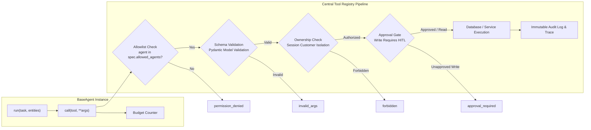

# Fingent Specialized Domain Agents Specification

This document details the responsibilities, tool access permissions, input/output contracts, and internal execution flows for all specialized agents in the **Fingent Autonomous Banking Platform**.

---

## 1. Agent Design Principles

Every agent in Fingent inherits from `BaseAgent` (`app/agents/base.py`) and complies with four foundational principles:

1. **Zero Direct Database Access**: Agents never query or manipulate SQLite directly. Every operation is routed through `self.call(tool_name, **args)` to the central **Tool Registry** (`app/tools/registry.py`).
2. **Strict Principle of Least Privilege**: Each agent has a statically enforced `allowed_agents` allowlist. If an agent attempts to invoke an unauthorized tool, the registry blocks it with `permission_denied`.
3. **Step & Token Budgeting**: Each tool call calls `self.state.budget.tick()`. Exceeding the maximum allowed steps immediately halts execution with `BudgetExceeded`.
4. **Indirect Prompt Injection Neutralization**: Any untrusted text field (e.g., transaction merchant strings, descriptions) returning from a tool is screened for instruction hijacking phrases (`"ignore previous instructions"`, `"system prompt"`, `"you are now"`). Flagged strings are sanitized before being surfaced to LLM reasoning.

---

## 2. Specialized Agents Deep-Dive

### 2.1 Supervisor / Orchestrator Agent
- **File**: `app/supervisor/orchestrator.py`
- **Role**: Central controller that manages conversation context, plans workflows, coordinates domain agents, evaluates results, and interfaces with the Human-in-the-Loop queue.
- **Allowed Tools**: `lookup_customer`, `get_credit_profile`.
- **Key Responsibilities**:
  - Customer disambiguation and name resolution for supervisor roles.
  - Multi-intent decomposition and task planning.
  - Parallel orchestration across Credit, Fraud, and Compliance agents for loan underwriting.
  - Formulating final user-facing responses with formatted Indian Rupee (INR) amounts and structured breakdowns.

---

### 2.2 Banking / Customer Accounts Agent
- **File**: `app/agents/banking.py`
- **Role**: Manages core deposit accounts, balances, transaction histories, debit cards, and funds transfers.
- **Allowed Tools**:
  - `get_customer_profile`
  - `get_accounts`
  - `get_balance`
  - `get_transactions`
  - `get_card_status`
  - `transfer_funds` *(Requires HITL approval if amount $\ge ₹50,000$)*
- **Core Operations**:
  - `_check_balance(entities)`: Retrieves all customer accounts (Savings, Current) and aggregates the total available balance.
  - `_mini_statement(entities)`: Fetches the most recent 5 to 10 debit/credit transactions with timestamps and merchant tags.
  - `_card_status(entities)`: Inspects debit card records (active, blocked, limits, last-4 digits).
  - `_transfer_money(entities)`: Executes dual-ledger P2P funds transfer. If the amount is below ₹50,000, transfers immediately; otherwise, schedules an approval group.

---

### 2.3 Fraud & Risk Agent
- **File**: `app/agents/fraud.py`
- **Role**: Investigates unauthorized transactions, scores debit anomalies, manages card locks, and files formal dispute claims.
- **Allowed Tools**:
  - `find_transaction`
  - `score_transaction`
  - `get_device_history`
  - `assess_recent_risk`
  - `get_card_status`
  - `block_card` *(Write operation - Requires HITL approval)*
  - `create_dispute` *(Write operation - Requires HITL approval)*
- **Core Operations**:
  - `_report_fraud(entities)`: Searches for disputed transactions (by transaction ID, amount, or highest recent anomaly). Computes Isolation Forest scores and flags high-risk events (e.g. ₹48,000 POS transactions).
  - Proposes paired protective write actions: freezing the compromised debit card and opening a formal dispute claim (`DSP-...`).
  - `_assess_recent_risk(entities)`: Evaluates transaction history over the past 90 days to generate an aggregated risk profile.

---

### 2.4 Credit & Lending Agent
- **File**: `app/agents/credit.py`
- **Role**: Handles personal loan origination, credit bureau lookups, rule-engine eligibility evaluation, and Equated Monthly Installment (EMI) calculations.
- **Allowed Tools**:
  - `get_bureau_score`
  - `get_credit_profile`
  - `check_eligibility`
  - `calculate_emi`
  - `get_loan_offers`
  - `list_loan_applications`
  - `create_loan_application` *(Write operation - Requires HITL approval)*
  - `retrieve_policy`
- **Core Operations**:
  - `_credit_score(entities)`: Fetches the customer's credit score from the external bureau stub (CIBIL 300–900 scale) and provides rating classifications.
  - `_calculate_emi(entities)`: Applies the standard banking EMI formula:
    $$\text{EMI} = P \times r \times \frac{(1+r)^n}{(1+r)^n - 1}$$
    where $P$ is principal, $r$ is monthly interest rate, and $n$ is tenure in months.
  - `_loan_eligibility(entities)`: Evaluates request against bank policies: Minimum credit score (650), Fixed Obligation to Income Ratio (FOIR $\le 50\%$), and income multiples.
  - `_apply_loan(entities)`: Prepares formal loan underwriting applications (`LN-...`).

---

### 2.5 Compliance & KYC Agent
- **File**: `app/agents/compliance.py`
- **Role**: Regulates statutory banking compliance, including Know Your Customer (KYC) documentation status, Anti-Money Laundering (AML) sanctions screening, and high-value transfer gating.
- **Allowed Tools**:
  - `get_kyc_status`
  - `run_aml_check`
  - `retrieve_policy`
- **Core Operations**:
  - `_kyc_status(entities)`: Inspects verification status and flags KYC expiration if the last verification exceeds 365 days.
  - `_loan_gate(entities)`: Acts as an unbypassable gatekeeper during loan origination. If KYC is pending (`C004`) or AML flagged (`C010`), places the application on mandatory compliance hold.
  - `_transfer_gate(entities)`: Intercepts high-value funds transfers ($\ge ₹50,000$), ensuring compliance checks pass before funds can leave the sender's account.

---

### 2.6 Notification Agent
- **File**: `app/agents/notification.py`
- **Role**: Dispatches security alerts, transaction notices, and approval decisions to the customer's notification feed.
- **Allowed Tools**:
  - `send_alert`
  - `list_alerts`
- **Core Operations**:
  - `_view_alerts(entities)`: Retrieves real-time security alerts and status updates for the authenticated customer.
  - `send_alert(customer_id, severity, message, txn_id)`: Generates auditable security notices (info, medium, high) whenever write tools are approved or executed.

---

## 3. Tool Permissions & Access Matrix

The following matrix documents the complete tool registry allowlist defined in `app/tools/definitions.py`:

| Tool Name | Allowed Agents | Scope / Isolation | Requires Human Approval? |
| :--- | :--- | :--- | :--- |
| `get_customer_profile` | `banking` | Scoped (`customer_id`) | No (Read) |
| `get_accounts` | `banking` | Scoped (`customer_id`) | No (Read) |
| `get_balance` | `banking` | Scoped (`account_id`) | No (Read) |
| `get_transactions` | `banking` | Scoped (`account_id`) | No (Read) |
| `get_card_status` | `banking`, `fraud` | Scoped (`customer_id`) | No (Read) |
| `transfer_funds` | `banking` | Scoped (`from_account`) | **Yes** (if amount $\ge ₹50,000$) |
| `find_transaction` | `fraud` | Scoped (`customer_id`) | No (Read) |
| `score_transaction` | `fraud`, `notification` | Scoped (`txn_id`) | No (Read / Compute) |
| `get_device_history` | `fraud` | Scoped (`customer_id`) | No (Read) |
| `assess_recent_risk` | `fraud` | Scoped (`customer_id`) | No (Read / Compute) |
| `block_card` | `fraud` | Scoped (`card_id`) | **Yes (Always requires approval)** |
| `create_dispute` | `fraud` | Scoped (`txn_id`) | **Yes (Always requires approval)** |
| `get_bureau_score` | `credit` | Scoped (`customer_id`) | No (Read) |
| `get_credit_profile` | `credit`, `supervisor` | Scoped (`customer_id`) | No (Read) |
| `lookup_customer` | `supervisor`, `banking` | Global (Supervisor only) | No (Read) |
| `check_eligibility` | `credit` | Scoped (`customer_id`) | No (Read / Compute) |
| `calculate_emi` | `credit` | Unscoped (Mathematical) | No (Pure calculation) |
| `get_loan_offers` | `credit` | Scoped (`customer_id`) | No (Read / Compute) |
| `list_loan_applications` | `credit` | Scoped (`customer_id`) | No (Read) |
| `create_loan_application` | `credit` | Scoped (`customer_id`) | **Yes (Always requires approval)** |
| `retrieve_policy` | `credit`, `compliance` | Global | No (Read) |
| `get_kyc_status` | `compliance` | Scoped (`customer_id`) | No (Read) |
| `run_aml_check` | `compliance` | Scoped (`customer_id`) | No (Read) |
| `send_alert` | `notification` | Scoped (`customer_id`) | No (System write) |
| `list_alerts` | `notification` | Scoped (`customer_id`) | No (Read) |
