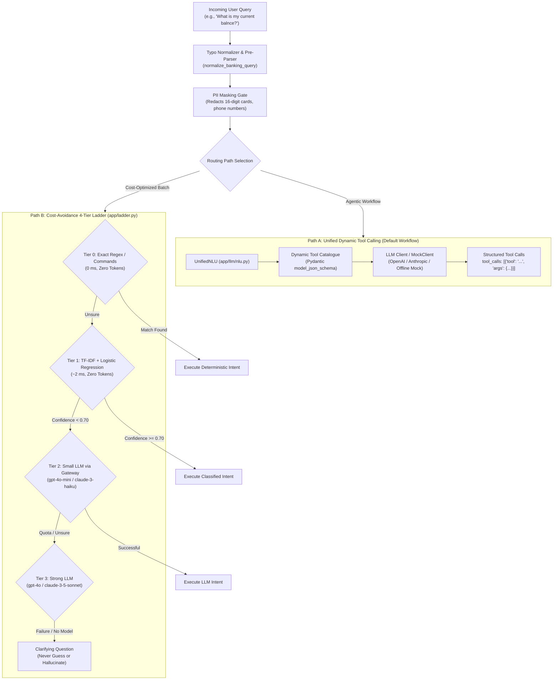

# Fingent NLU, Cost-Avoidance Ladder & Dynamic Tool Calling

This document explains the Natural Language Understanding (NLU) architecture of **Fingent**, including the **4-Tier Cost-Avoidance Ladder**, native structured tool calling, typo normalization, and the offline Mock intelligence engine.

---

## 1. Dual NLU Strategy: Cost Optimization vs. Model Flexibility

A critical challenge in enterprise AI banking systems is preventing astronomical LLM token costs and latency bottlenecks for high-frequency, routine queries (e.g., checking an account balance or viewing a statement). Fingent solves this using a **Dual NLU Architecture**:



---

## 2. The 4-Tier Cost-Avoidance Ladder

Defined in `app/ladder.py`, the ladder ensures requests start at the cheapest deterministic tier and only escalate to larger models when ambiguity exists:

### Tier 0: Deterministic Regex & Commands
- **Latency**: $\approx 0\text{ ms}$
- **Token Cost**: $0\text{ tokens}$ ($₹0.00$)
- **Mechanics**: Matches standardized commands and precise regex patterns (e.g. `^balance$`, `^mini statement$`, `^card status$`).

### Tier 1: Local Statistical Machine Learning
- **Latency**: $\approx 2\text{–}5\text{ ms}$
- **Token Cost**: $0\text{ tokens}$ ($₹0.00$)
- **Mechanics**: Utilizes a TF-IDF vectorizer combined with a Scikit-Learn `LogisticRegression` model trained on curated banking utterances (`app/ml/training_data.py`). If model prediction confidence exceeds the threshold ($\ge 0.70$), execution proceeds immediately without external network requests.

### Tier 2: Small Language Model via Gateway
- **Latency**: $\approx 400\text{–}800\text{ ms}$
- **Token Cost**: Bounded ($\approx 150\text{–}300\text{ tokens}$)
- **Mechanics**: Dispatched through `Gateway.call()` to efficient, low-cost models (e.g. `gpt-4o-mini`). Protected by strict per-request token caps and PII redaction.

### Tier 3: Strong Foundation Model
- **Latency**: $\approx 1000\text{–}2500\text{ ms}$
- **Token Cost**: Premium
- **Mechanics**: Engaged only when Tier 2 reports uncertainty or when complex reasoning is required.

### Fallback: Transparent Clarification
If no LLM provider is available or models fail, the ladder **refuses to guess or hallucinate**. Instead, it generates a focused clarifying question, returning control to the user.

---

## 3. Native Structured Tool / Function Calling

When configured with an external LLM (`LLM_PROVIDER=openai` or `LLM_PROVIDER=anthropic`), Fingent supplies OpenAI-compatible and Anthropic JSON function schemas dynamically derived from registered Pydantic argument models:

```python
# Generated schema example passed to the LLM:
{
    "name": "calculate_emi",
    "description": "Calculates monthly EMI given loan amount, interest rate, and tenure.",
    "parameters": {
        "type": "object",
        "properties": {
            "amount": {"type": "number", "minimum": 1.0, "maximum": 1000000000.0},
            "annual_rate": {"type": "number", "minimum": 0.0, "maximum": 60.0},
            "tenure_months": {"type": "integer", "minimum": 1, "maximum": 360}
        },
        "required": ["amount", "annual_rate", "tenure_months"]
    }
}
```

### The LLM Tool Calling Protocol:
1. The client message is packaged with system instructions and JSON tool schemas.
2. The LLM returns structured tool invocations:
   $$\text{tool\_calls: } [\{\text{"name": "get\_balance"}, \text{"arguments": } \{\dots\}\}]$$
3. Arguments are deserialized and strictly validated against Pydantic models.
4. Calling permissions and customer isolation scopes are verified before execution against SQLite.
5. Structured results are injected back into the response context for final answer assembly.

---

## 4. Offline Intelligence & Dynamic Mock Engine

To ensure full demo availability, deterministic automated testing, and development without external API keys, Fingent includes a comprehensive offline engine (`app/llm/mock.py`):

- **No API Keys Required**: `LLM_PROVIDER=mock` runs locally with zero external network dependencies.
- **Dynamic Semantic Parsing**: Extracts numerical amounts (including Indian currency notations like *"5 lakh"* $\rightarrow 500,000$, *"₹48k"* $\rightarrow 48,000$), tenures (years, months), and transaction identifiers across arbitrary natural language paraphrases.
- **Multi-Intent Decomposition**: Composite utterances such as:
  > *"What is my balance, and show me my last five transactions?"*
  
  are parsed into two distinct tool calls (`get_balance` and `get_transactions`) executed in sequence.
- **Conversational Dialogue & Natural Greetings**: Non-banking pleasantries (*"Hi"*, *"Good morning"*, *"How can you help?"*) are resolved immediately with natural conversational answers without invoking financial tools.

---

## 5. Typo Normalization & Colloquial Language Handling

Users interacting with banking chatbots frequently type hurriedly with spelling errors. The pre-NLU typo normalizer (`app/llm/typo_normalizer.py`) intercepts queries and normalizes common domain errors:

| User Input (Colloquial / Misspelled) | Normalized Form | Resolved Intent |
| :--- | :--- | :--- |
| *"what is my current balnce?"* | *"what is my current balance?"* | `check_balance` |
| *"whats my acount balence"* | *"what is my account balance"* | `check_balance` |
| *"can u show my recnt transctions"* | *"can you show my recent transactions"* | `mini_statement` |
| *"i want to sned 2000 to diya"* | *"i want to send 2000 to diya"* | `transfer_money` |
| *"can i get a lone of 5 lakh"* | *"can i get a loan of 5 lakh"* | `loan_eligibility` |
| *"check my cbil scor"* | *"check my cibil score"* | `credit_score` |
| *"plz blck my crd"* | *"please block my card"* | `block_card` |
