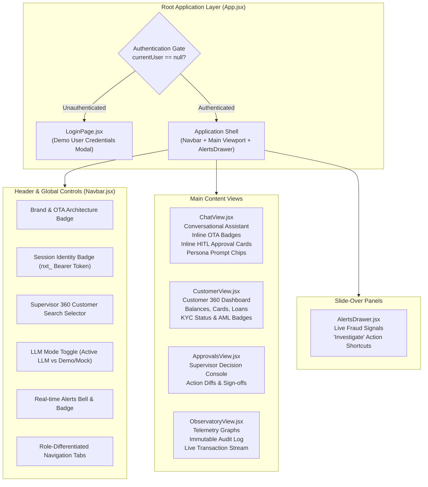

# Fingent Frontend Architecture & Observability Observatory

This document describes the presentation layer, component hierarchy, client-side state management, and real-time observability telemetry implemented in the **Fingent Frontend** (`frontend/`).

---

## 1. Frontend Technology Stack & Design System

The client is built using modern web standards without external bloated framework overhead:
- **Framework**: React 18 + Vite SPA.
- **Styling**: Vanilla CSS (`src/App.css`, `src/index.css`) featuring a custom **Obsidian Glassmorphism** design system.
- **Typography**: Inter / Outfit system font stacks with monospace accents for financial IDs, currency figures, and trace tokens.
- **Iconography**: `lucide-react` for crisp vector iconography.
- **State Management**: React Hooks (`useState`, `useEffect`, `useCallback`, `useRef`) paired with isolated `sessionStorage` persistence.



---

## 2. Component Hierarchy & Responsibilities

### 2.1 `LoginPage.jsx`
- Intercepts unauthenticated users on first load.
- Provides immediate one-click demo credentials for Customers (`C001` through `C010`) and Supervisors (`supervisor`, `rm001`).
- Submits to `POST /auth/login` and initializes the secure session.

### 2.2 `Navbar.jsx`
- Displays the authenticated persona with explicit role coloration (Customer = Blue, Supervisor = Purple).
- **Supervisor-Only Persona Selector**: Allows operations leads to switch the active 360 customer profile without re-logging.
- **Offline / LLM Toggle**: Allows toggling between live external model calls and the local deterministic mock engine in real-time.
- **Alerts Indicator**: Shows unread high-priority fraud alerts with pulsing status indicators.

### 2.3 `ChatView.jsx` (Interactive Multi-Agent Assistant)
- **Conversational Stream**: Displays natural language exchanges between customer and agents.
- **Inline Observe–Think–Act Accordion**: Every agent response features an expandable telemetry card detailing:
  - Phase 1 Observe: Extracted goal, detected intent, entity dictionary.
  - Phase 2 Think: Planned subtasks and required domain agents.
  - Phase 3 Act: Real tool executions with individual latency measurements.
  - Phase 4 Evaluate: Self-evaluation checks passed or failure categories.
- **Inline HITL Approval Cards**: Sensitive write actions (card blocking, dispute filing, loan origination) display inline interactive cards with **Approve** and **Reject** buttons. Approving updates the chat stream optimistically.
- **Customer Snapshot Sidebar**: Live overview of the customer's accounts and active cards.
- **Persona Prompt Chips**: Quick-start prompts curated for each customer scenario.

### 2.4 `CustomerView.jsx` (Customer 360 Dashboard)
- **Account Balances**: Card-based display of Savings, Current, and Fixed Deposit accounts.
- **Debit Card Controls**: Displays active card limits, status tags (Active vs. Blocked), and quick-block shortcuts.
- **Credit Profile & Loans**: CIBIL credit score meter, existing EMI obligations, and active loan applications.
- **KYC & Regulatory Compliance**: KYC verification status, last verified timestamp, and AML watchlist flags.
- **Transaction Ledger**: Searchable, paginated table of recent transactions with fraud risk scores.

### 2.5 `AlertsDrawer.jsx`
- Real-time slide-over drawer polling alerts from `GET /alerts`.
- Color-coded severity indicators (`high`, `medium`, `info`).
- Clicking **"Investigate"** automatically switches to `ChatView` and injects a triage query into the agent console.

---

## 3. Client State Management & Session Isolation

To guarantee that switching tabs or customers does not leak conversational state or crash the UI, the frontend implements multi-tier state isolation:

1. **Session-Scoped Chat Persistence**:
   - Conversations are persisted to `sessionStorage` using composite keys:
     ```javascript
     const storageKey = `fingent_chat_${customerId}_${role}`;
     const convKey = `fingent_conv_${customerId}_${role}`;
     ```
   - This ensures that navigating between Customer 360 views and the chat console preserves message history while isolating customer records.
2. **Centralized API Client (`src/api.js`)**:
   - Manages the stored Bearer token (`localStorage.getItem('fingent_auth_token')`).
   - Automatically injects `Authorization: Bearer nxt_<hex>` headers into all outbound requests.
   - Automatically clears tokens and redirects to the login screen upon receiving `HTTP 401 Unauthorized`.
3. **Telemetry Polling Interval**:
   - A global heartbeat interval in `App.jsx` polls `GET /auth/me`, `GET /alerts`, and `GET /approvals/pending` every 8 seconds, ensuring dashboard counters remain synchronized with backend events.
